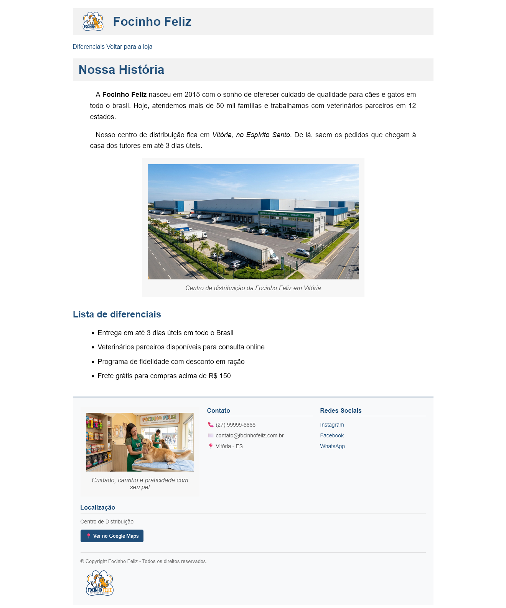

# 🐾 Focinho Feliz

Página institucional ("Sobre nós") de um pet shop fictício, desenvolvida como atividade da disciplina **Fundamentos de Desenvolvimento Web** no CEET Vasco Coutinho.

🔗 **Ver o site no ar:** [adrianoliveiradev.github.io/focinhofeliz](https://adrianoliveiradev.github.io/focinhofeliz/)

## 📸 Prévia

## ✨ O que a página tem

- Cabeçalho com logo e menu de navegação
- Seção "Nossa História" com texto e foto do centro de distribuição
- Lista de diferenciais da empresa
- Rodapé com contato, redes sociais, link para o Google Maps e direitos autorais

## 📚 O que eu pratiquei

- Estrutura semântica em HTML5 (`nav`, `figure`, `figcaption`, listas)
- Estilização com CSS: Flexbox, cores, tipografia e espaçamentos
- Seletores de `id` e de classe, e efeitos de `hover` em links e botões
- Organização dos arquivos em pastas (imagens e estilos)
- Publicação de um site com GitHub Pages

## 🛠️ Tecnologias

 

## ▶️ Como ver o projeto

1. Acesse o [site no ar](https://adrianoliveiradev.github.io/focinhofeliz/), ou
2. Baixe ou clone este repositório e abra o arquivo `index.html` no navegador.

## 📝 Observação

Projeto educacional. A empresa, os números e os contatos que aparecem na página são fictícios.

## 👤 Autor

**Adrian de Oliveira Prates**
Estudante do curso Técnico em Informática — CEET Vasco Coutinho

